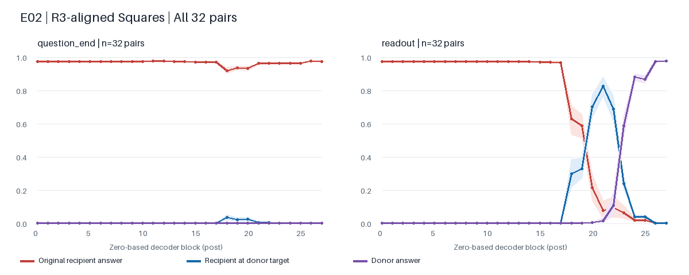
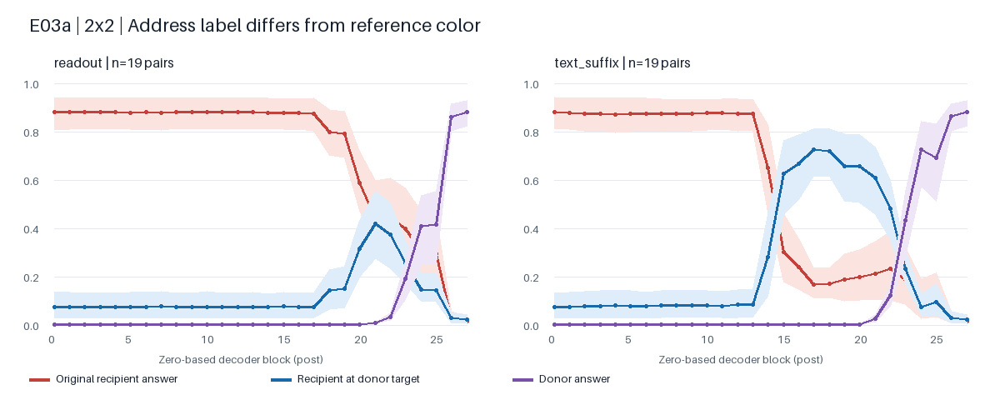

<!-- 记录真实 E02/E03 结果、关键反例、排混淆过程和本轮停点，不把部分路径当完整机制。 -->
# E02 已复现；E03 的“单 token 地址接口”需要改写

2026-10-20。完成 **14 次真实 GPU run、12,840 次模型前向**（含干预、基线与一致性检查）。
各 run 壁钟耗时合计 12.88 分钟，含加载和统计；这些调用不是独立样本数量。
E02 主复现、E03a 端口检验、E03b 分组中介与在线组件写入冻结均执行，并完成预先冻结的留出比较。

## 本轮改变了什么

**保留关系寻址问题，不将最终读出 token 的完整残差默认作为通用目标地址 U。**
同一个模型能正确回答两个问题，不保证把其中一个末位置全状态搬到另一个场景就迁移目标位置。
其他文本位置会改变迁移结果；一维反例还有“预期位置色=参照色”的角色混淆，不能据此宣称地址不存在。
二维排混淆后仍有明确的位置迁移，但完整后缀的覆盖高于单 readout。

E03b 已到**位置组依赖与条件写入依赖**，尚未恢复产生目标选择的具体 head/MLP 算法。
本轮止于这个会改变实验路线的接口反例；E03c 的共享仿射算子拟合、完整 E03d 机制预测、E04/E05未执行。
仿射关系算子、候选比较和预存邻接三类主解释仍待判别。

## 1. 最接近前作的结果确实复现了

[R3 §5.1](https://arxiv.org/html/2603.22278v3#S5.SS1) 通过末位置残差移植，报告先迁移目标位置、
再迁移颜色的阶段模式。[作者实现](https://github.com/Nix07/spatial-variable-binding/blob/main/last_token_exp/src/patch.py)
实际替换追加 generation prompt 后的 `-1`，而不是图示中的 is 词；本项目同时记录实际读出和问题末词。

主复现使用其336px、56px Squares、间距56px、原调色板及系统提示。32对全部双端基线正确：
- 第21层：31/32次转向接收图在 donor 目标位置的颜色，平均概率0.824，族bootstrap区间[0.766,0.880]。
- 第24层：32/32次转向 donor 自身答案。
- 改成与动态参照相同的 immediately 措辞后，第21层仍有29/32位置迁移；冻结测试为14/16。

与前作的一致性是阶段模式，不要求浮点结果完全一致：本项目使用HF原生BF16/SDPA、batch=1和新图像束，
不是作者的vendored TransformerLens；本轮只扫零起点block-post 0–27，不包含独立post-embedding槽。

## 2. 动态参照使末位置全状态的解释失效

固定问题文字和关系，让图中同一参照移位；区分接收图原答案a、接收图的donor目标位置颜色b、donor自身答案c。
三者不同，不把答案随便翻转计成功。

一维正向：discovery 14/16对双端正确，readout扫全部28层仍没有一次b选择；冻结test的5个双端正确配对也如此。
完整suffix在第18层则为9/14，冻结test为2/5。反向移植的readout第21层可达9/11，表明效应有角色/方向依赖。
但正向b总是接收图参照色，既可能受参照排除约束，也可能混入参照属性泄漏；这组反例不能单独决定地址机制。
原无immediately的v1还存在边缘参照的语言歧义，保留为语义诊断，不并入主机制结论。

### 二维控制排除了“b恰为参照色”

2×2四个对象颜色唯一；同指令、同参照身份，仅参照换到另一个合法行/列。a、b、c与参照色四者不同，
c不出现在接收图中。每族四方向，discovery32对；其中19对双端正确。

| 已冻结比较 | discovery位置迁移 | validation位置迁移 | test位置迁移 |
| --- | ---: | ---: | ---: |
| readout第21层 | 8/19 | 1/9 | 5/11 |
| 完整suffix第17层 | 15/19 | 8/9 | 8/11 |

分母是双端原始均答对的配对数，不是任务总体正确率。Test覆盖11/16对、4族；其族区间较宽：
readout位置迁移率0.455 [0.111,0.667]，suffix为0.727 [0.300,1.000]。
保留全部模型输出与正确性覆盖，未按干预成功率筛选。

在更严格的discovery真值切片中，b完全不出现在donor图中：双端正确12对，readout为6/12，suffix为9/12。
因此二维确有跨图目标位置迁移证据，也不能把一维失败扩大为“整个模型没有可迁移地址”。
这组数据不建立两种端口差异的总体显著性结论；它提供单readout并非稳定通用接口的具体反例。

### 一个排除了参照色与donor颜色污染的具体反例

配对`p19-family-0004-grid2-refmove-right`，问题为：`The color of the square immediately to the right of the green square is`。

| 图像 | 上排（左→右） | 下排（左→右） | 原始正确答案 |
| --- | --- | --- | --- |
| 接收图 | green / black | gray / blue | black |
| donor图 | gray / brown | green / red | red |

预期位置迁移为`blue`，该颜色既不是参照色，也完全不出现在donor图中。
只移入第21层readout后回答`black`；移入第17层完整suffix后回答`blue`。
两次未干预原始问答均正确。这是“末位置全状态直接作为通用地址”的具体失败例，
同时也是更完整状态可迁移目标位置的正例；不依赖从颜色推定唯一误选对象。

## 3. 实际依赖分布在多个位置

沿已经成功恢复b的完整suffix，互斥划分vision_end、参照描述、问题尾部、assistant边界/标记、关系词和其他词。
每组分别做“只移入donor组”与“移入完整donor suffix后恢复clean组”。完整suffix包含vision_end，未改视觉token。

- Discovery第17层：完整suffix为9/14；只恢复clean参照描述后降至0/14；单独移入参照组只有3/14。
- Discovery第18层：恢复clean问题尾部或assistant组，均把完整suffix的9/14降至0/14。
- 固定同层、同组后，test第17层完整suffix为2/5，恢复clean参照组后0/5；第18层恢复问题尾部或assistant也为0/5。

这支持**这些位置参与同一恢复效应**。它们的全状态混有身份、场景与答案，尚不能分别命名为纯R或纯U。
当前应保留多位置读取/重读路径，而不是把这些向量拼接后直接宣称得到关系算法。

## 4. MLP在线变化有关，但还没有定位地址运算

同图分别只改关系、只改参照，把新问题的文本MLP输出固定为旧问题值；模型参数始终冻结。
文本范围从vision_end之后到assistant读出，不包含视觉前缀。另固定16–22层MLP，attention冻结作通信控制。

| Test正确基线子集 | 自然新问题 | 全文本MLP旧写入 | 16–22层MLP旧写入 | 全文本attention旧写入 |
| --- | ---: | ---: | ---: | ---: |
| 关系变化 | 8/8 | 0/8 | 5/8 | 0/8 |
| 参照变化 | 9/9 | 0/9 | 2/9 | 0/9 |

这个结果反驳“无需文本MLP条件变化即可维持新选择”的强简化，但不证明MLP在计算仿射地址变换。
全部MLP冻结同时涉及条件传播、选择与颜色读取；attention冻结切断跨token通信，本身不定位关系算子。
三种功能仍需分开测量，不能从最终颜色直接反推中间算法。

## 5. 当时停点与后续建议

本节保留执行结束时的建议。独立评审后已改为“原生属性读取端回溯优先，中继为辅助”，
当前路线与编号见 [研究决策](../research/07_outcomes_and_decisions.md)；下文不作为当前执行前提。

本轮检验了一个操作化假设：E02位置迁移窗口的末状态，能否作为动态参照实验的通用地址端口。
实测不支持把这个接口默认化。原生多位置依赖与二维反例使这个代理接口不够可靠；
继续套仿射回归不能回答“关系怎样生成目标地址”。

下一步应先完成**地址中继读出**协议：在生产上下文中局部干预候选组件，再把其中间状态接入独立图像的
已校准读取端口，以目标位置而非生产图颜色测量组件作用。要先验证中继本身的适用条件和覆盖。
随后区分：候选MLP/attention增量是在改变地址，还是传递关系、参照身份或答案属性。
这是沿R3功能读出继续推进的具体方法，而不是再扩大颜色干预矩阵。

E01原五布局的validation/test没有因此全部评估；本轮留出属于声明的Squares/动态参照协议。
二维仍是2×2，尚未得到更密网格、自然图像、第二模型或低维算子的完整机制结论。

## 6. 实现、有效性与复现

- 新入口：e02、e03、e03_grid、e03_path、e03_freeze；旧E01 smoke/formal契约保留。
- 原生端口：block-post残差、attention/MLP写入、pre-O query-head输出和Q/K/V投影；本轮未实现K-cache集合搜索。
- 实际聊天token/视觉grid、逐问概率、全量与正确子集、按族区间、配置及源码快照均保存。
- 原有generate与原生readout候选log概率差值0；逐层自身替换和恢复的完整词表logits差值0。
  多位置完整序列donor状态移植亦恢复donor logits，差值0。
- 本地CPU全量检查199通过、2项Torch跳过；后续新增二维/冻结测试单独通过。
  最终相关科学测试在Mac为56通过、2项Torch跳过，新增配置检查另2项通过；
  同一最终源码在Linux已有Torch环境59项全部通过，没有在Mac安装GPU栈。
- 已核对真实数据和渲染、CLI prepare-only、Ruff及包构建。最终Linux科学测试、真实CLI预检与最终wheel入口均已检查。
- 基准commit为`0a39a4504f3a54a676d004405f0e77e761ce3561`加实际工作区改动；每个run保存自己的diff与未跟踪源码全文，
  不把当前HEAD冒称当次执行代码。
- checkpoint权重revision `2cbada593a2b4c785cd4b8bbb27d7a3f50d45b70`；processor逐文件来源随run保留。
  Python3.12.3继承镜像、Torch2.8.0+cu128、Transformers4.57.1，BF16、SDPA、无量化/CPU offload。
- 峰值allocated 15.52 GiB，reserved 15.56 GiB。Tracking/OSS关闭。
- 全部14个run已本地备份至`runs/autodl/`；作业结束后GPU空闲，实例未关机，仍会计费。

## 运行索引

每行是一次执行，多个run会复用配对，不把它们合并为更多独立样本。汇总链接含完整系列和族区间。

| Run ID | 执行划分 | 配对/案例数 | 模型前向 | 壁钟秒 | 产物 |
| --- | --- | ---: | ---: | ---: | --- |
| `20261020T051206333146Z-e02-squares-discovery-d2ea1545` | discovery | 32 | 1914 | 95.62 | [汇总](../../runs/autodl/20261020T051206333146Z-e02-squares-discovery-d2ea1545/artifacts/patching/summary.json) |
| `20261020T051532120363Z-e03a-reference-move-71c52e5e` | discovery | 16 | 986 | 53.47 | [汇总](../../runs/autodl/20261020T051532120363Z-e03a-reference-move-71c52e5e/artifacts/patching/summary.json) |
| `20261020T051709031947Z-e03a-adjacent-refmove-4e5cd236` | discovery | 16 | 986 | 55.06 | [汇总](../../runs/autodl/20261020T051709031947Z-e03a-adjacent-refmove-4e5cd236/artifacts/patching/summary.json) |
| `20261020T052024374600Z-e02-matched-adjacent-dc393102` | discovery | 32 | 1914 | 95.84 | [汇总](../../runs/autodl/20261020T052024374600Z-e02-matched-adjacent-dc393102/artifacts/patching/summary.json) |
| `20261020T052256208276Z-e03a-suffix-control-c4167205` | discovery | 16 | 988 | 62.20 | [汇总](../../runs/autodl/20261020T052256208276Z-e03a-suffix-control-c4167205/artifacts/patching/summary.json) |
| `20261020T052359564275Z-e03a-reverse-control-68a2eb17` | discovery | 13 | 814 | 52.05 | [汇总](../../runs/autodl/20261020T052359564275Z-e03a-reverse-control-68a2eb17/artifacts/patching/summary.json) |
| `20261020T052629647768Z-e03b-token-mediation-b6221765` | discovery | 16 | 1072 | 71.21 | [汇总](../../runs/autodl/20261020T052629647768Z-e03b-token-mediation-b6221765/artifacts/mediation/summary.json) |
| `20261020T052937425460Z-e02-frozen-heldout-2dd52fb7` | validation/test | 32 | 132 | 15.09 | [汇总](../../runs/autodl/20261020T052937425460Z-e02-frozen-heldout-2dd52fb7/artifacts/patching/summary.json) |
| `20261020T052953413782Z-e03a-frozen-heldout-d00b7095` | validation/test | 16 | 988 | 59.19 | [汇总](../../runs/autodl/20261020T052953413782Z-e03a-frozen-heldout-d00b7095/artifacts/patching/summary.json) |
| `20261020T053053610402Z-e03b-frozen-heldout-253972bb` | validation/test | 16 | 448 | 35.46 | [汇总](../../runs/autodl/20261020T053053610402Z-e03b-frozen-heldout-253972bb/artifacts/mediation/summary.json) |
| `20261020T053516374391Z-e03a-grid2-discovery-f27868d5` | discovery | 32 | 1916 | 103.95 | [汇总](../../runs/autodl/20261020T053516374391Z-e03a-grid2-discovery-f27868d5/artifacts/patching/summary.json) |
| `20261020T053831209424Z-e03b-conditional-freeze-095b75b3` | discovery | 48 | 241 | 27.22 | [汇总](../../runs/autodl/20261020T053831209424Z-e03b-conditional-freeze-095b75b3/artifacts/freezing/summary.json) |
| `20261020T054108391876Z-e03a-grid2-frozen-a1753759` | validation/test | 32 | 200 | 17.84 | [汇总](../../runs/autodl/20261020T054108391876Z-e03a-grid2-frozen-a1753759/artifacts/patching/summary.json) |
| `20261020T054127223737Z-e03b-freeze-frozen-cd718b2a` | validation/test | 48 | 241 | 28.82 | [汇总](../../runs/autodl/20261020T054127223737Z-e03b-freeze-frozen-cd718b2a/artifacts/freezing/summary.json) |
