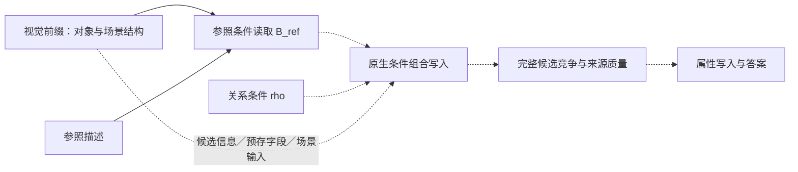

<!-- 维护可检验的计算假说、等价范围与证据门槛，不预设纯地址或仿射算子。 -->
# 机制假说：动态参照条件怎样形成

本章属于工作假说与推导。地址是否可分离、算子出现在哪里、是否跨场景共享，均待实测。
符号和物理端口以 [03](03_interfaces_and_notation.md) 为准。

## 1. 假设希望解释的链条

此图是待验证的计算链，不是已恢复电路。独立目标地址 U 仅在证据支持时加入；
候选竞争后直接读属性、多个位置协作或字段选择均允许。候选空间投影 R 是分析工具，不是新增模型层。

### 2026-10-20的实验约束

[已有结果](../reports/e02_e03_2026-10-20.md)显示，最终token的整状态不能自动当作上图U；
参照、问题尾部和assistant状态参与特定后缀恢复效应。MLP在线写入冻结会影响新选择，但尚未分清
它作用于条件传播、地址选择还是属性读取。共享仿射与门控MLP均继续作为工作假说，不能因模型结构
可表达该运算或因冻结有效而视为已验证。优先从原生属性消费端回溯动态条件形成；
中继不作前置依赖。2×2 上复制参照行／列再按方向选边界可能足够，先用 B03 排除这项退化。

## 2. 从最简单解释开始

M04–M06 先辨识原生选择路径，M07 对同一实际组件的条件写入增量比较：

$$
\widehat m=m_0+A B_{\mathrm{ref}}+C E_\rho,
\qquad
\widehat m=m_0+A(E_\rho)B_{\mathrm{ref}}+C E_\rho.
$$

B_ref 可能已含邻居、场景或目标信息；E_rho 也不是预先保证纯净的关系向量。
输入只来自已证实路径，m_0 不能是逐场景自由拟合的答案补偿项；写入后接回原生 norm、Q/K/V 和下游。
条件交互只有对应真实依赖且带来不同预测时才增加。MLP、attention 或短联合路径都可能执行该段计算。

若确实取得可辨认的 R/U，以下地址形式才成为相应特例：

$$
\text{加性基线：}\quad \widehat U=AR+c_\rho,
$$

$$
\text{关系条件仿射假说：}\quad \widehat U=A_\rho R+t_\rho.
$$

这两个特例使用相同的已验证地址接口、拟合数据和留出协议。维度/正则由 validation 选择；不能
为每张图重拟合。若加性基线同样好，就保留“共享映射＋关系偏置”的较小解释，不声称模型
选择了不同的变换矩阵。若只有加入场景信息才成功，应继续解释它从哪条原生路径进入。

仿射形式比强制齐次线性更合适：地址空间的一步平移可能表现为关系相关偏置。
写成齐次坐标仅是表示技巧：

$$
\widetilde R=[R;1],\qquad
\widetilde T_\rho=
\begin{bmatrix}A_\rho&t_\rho\\0&1\end{bmatrix}.
$$

这不把代数重写本身当作算法或机制发现。

## 3. 共享地址移位的可选补充预测

若在已标定的共同地址空间里，$b_{u,v}$ 是场景内地址码，则直接相邻任务预测：

$$
T_{\mathrm{left}}(b_{u,v})\approx b_{u,v-1},\qquad
T_{\mathrm{right}}(b_{u,v})\approx b_{u,v+1}.
$$

假说预测算子跨参照身份、属性和模板共享。行列不预先等同像素坐标，空位/最近对象语义另设任务。
几何映射可拟合不等于原生路径执行该映射；本节性质和下节 JVP/VJP 仅在能改变机制判断时使用。

在所有中间地址都有效的内部区域，可检验：

$$
T_R\circ T_L\approx\mathrm{id},\qquad T_U\circ T_R\approx T_R\circ T_U.
$$

这里下标 L/R/U 表示左/右/上。以下条件仅在已验证地址的有效仿射包上检查，
不能由少量位置推断完整残差空间的矩阵恒等：

$$
A_RA_L\approx I,\quad A_Rt_L+t_R\approx0,
$$

$$
A_UA_R\approx A_RA_U,\quad
A_Ut_R+t_U\approx A_Rt_U+t_R.
$$

这些等式要求共用地址空间和合法复合路径，不在边界强求环绕，也不把不同层未对齐的矩阵
直接相乘。平移后的场景若采用新的相对地址体系，应先解释这个体系，而非自由换基救拟合。

### 混合地址响应

对 $0\le\alpha\le1$，仿射假说预测：

$$
T_\rho(\alpha R_i+(1-\alpha)R_j)
=\alpha T_\rho(R_i)+(1-\alpha)T_\rho(R_j).
$$

实验只在声明的地址成分上构造混合，其他状态保持；比较的是下一接口的地址写入，最终
softmax 和行为本来就可非线性。混合可能离开自然表示分布，因此该检验是补充证据，需与
自然场景留出和真实 donor 干预一起判断；失败不能单独否定全部关系寻址结构。

## 4. 一个具体原生实现猜想：门控 MLP

按 [参考实现](02_related_work.md#c1)，Qwen2-VL 语言主干的门控 MLP 可写为：

$$
f(h)=W_d\,[\operatorname{SiLU}(W_gh)\odot W_uh].
$$

它具备让关系信号调制地址通路的结构条件，但架构能实现不等于模型实际这样做。
记 $g=W_gh,u=W_uh$，其 Jacobian 是：

$$
J_f(h)=W_d\left[
\operatorname{diag}(u)\operatorname{diag}(\operatorname{SiLU}'(g))W_g
+\operatorname{diag}(\operatorname{SiLU}(g))W_u
\right].
$$

若原生因果路径支持该组件，将已标定的地址方向映射到它的实际输入/输出，记为 $V_R,V_U$。
关系固定时检验 $V_U^\top J_f(h)V_R$ 是否在不同参照中稳定，并能预测有限 donor 变化。
这里的 $h$ 是实际 MLP 输入；若干预发生在残差流，还须包含 RMSNorm 等路径的链式导数。
跨多层路径使用对应组合函数的 Jacobian，不将孤立 MLP 的导数当作整条路径。

门控也可能随参照、场景变化而改变，导致共享 $A_\rho$ 失效。方向 JVP/VJP 可检验少量
地址方向，无需先构造完整 Jacobian。地址状态与组件写入增量分别建模，扣清残差携带部分。
MLP 不是预定答案；若证据指向 attention 或分布式路径，就按实际组件解释。

## 5. 两种重要竞争计算

### 候选比较后再写出目标地址

以有序候选的最近左邻为**单独语义的说明例**：

$$
s_j=\beta j-\lambda\mathbf1[j\ge i],\qquad\beta>0.
$$

在有限候选范围内取足够大的 $\lambda$，可排除参照右侧/自身，再偏好最近左邻。
这时 query 可以携带参照阈值，目标地址是候选竞争之后通过 OV 写出的，而非预先移位。
该公式说明一种竞争实现，不声称原模型使用它，也不用这个新增任务替代直接相邻主任务。

### 读取预先存在的邻接字段

若视觉记忆携带：

$$
V_i=[b_i,n_i^{L},n_i^{R},n_i^{U},n_i^{D},\ldots],\qquad
n_i^\rho=b_{\nu_\rho(i)},
$$

在线阶段可能主要是绑定参照与选择字段。判断这种解释需要证明原生读取确实使用相关
信息；能训练 probe 从位置预测邻居，不等于网络预存并读取了邻接字段。

### 何时合并解释

例如 U=r+d_rho、s_j=-||p_j-U||² 可以展开为候选比较；one-hot 地址上的邻接表也可以写成线性矩阵。
这类代数等价不是原生实现证据。候选内共同项只能在同一候选集合的条件 softmax 中消去；
若文本、特殊 token 同时参与竞争，还需保留候选总质量与完整 OV 输出，见 [03](03_interfaces_and_notation.md)。
只有相同原生接口、输入依赖和完整干预响应均无法区分时才合并，不为 A/B/C 标签强行分类。

## 6. 场景依赖是一条可发展的结果

较一般的候选模型为：

$$
U=f_\rho(R,C_{\mathrm{scene}})
=A_\rho R+t_\rho+H_\rho(C_{\mathrm{scene}})
+\sum_m c_m(C_{\mathrm{scene}})B_{\rho,m}R.
$$

它仅描述可能的加性与调制依赖，不是本轮要训练的复杂模型。若共享小映射失败，先定位
必要的输入路径，再判断额外场景依赖来自参照读取、候选比较还是更早预计算。
query 简单也不表示 key 简单；key 可能已经携带排序或场景摘要。

## 7. 什么证据才支持机制结论

1. 在自然输入上拟合中间状态，只建立计算近似。
2. 接入一个小算子后能答题，只建立功能充分性。
3. 同一冻结解释先预测局部原生输入干预后的实际写入、完整分数／来源质量和属性读取，
   再替代其声称解释的局部写入并预测下游，才推进计算依赖解释。

保留未解释残差可保持接口兼容，但不能把其中完成的条件计算算入已解释贡献。
高拟合、可解码或替代后答对都不足以越过该门槛；实际自然错误不能用真值输入修正后再预测。

“首次目标地址写入”指已检查并验证的因果路径中最早的实际地址贡献，不是全网络最早的
probe 峰值。需说明未检查的路径和并行贡献。关键检验及竞争解释的判别见 [06](06_experimental_design.md)。
